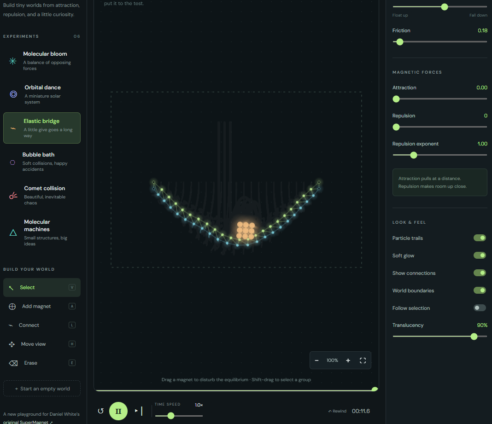

# Super Magnet Reloaded

A local, interactive particle laboratory based on Daniel White’s SuperMagnet. The original AMOS files are preserved without modification in the [`backwards-engineer/super-magnet`](https://github.com/backwards-engineer/super-magnet) repository, included here as the `super-magnet/` Git submodule.



## Run on Windows

Install Node.js (already available on this machine), then double-click **Start Super Magnet.cmd**. Keep the server window open. Or run `npm start` and visit **http://localhost:4173**. The server binds only to the local machine. There are no dependencies to install. External fonts are optional; system fonts work offline.

Clone with `git clone --recurse-submodules https://github.com/backwards-engineer/super-magnet-reloaded.git` to include the original reference source. The browser app also runs without the submodule.

## Explore

Six experiments: Molecular bloom, Orbital dance, Elastic bridge, Bubble bath, Comet collision, and Molecular machines. Drag particles to interact. Use the left toolbar to add, connect, pan, and erase. Shift-drag selects groups. Double-click a particle to inspect it. Space pauses; Delete removes selected particles. Wheel zooms; the fit button frames the particles.

Edit gravity, friction, attraction, inverse-power repulsion, and exponent live. The Inspector edits selected magnets, including defense, power, position, initial/current velocity, scheduled appearance, radius, colour, shape, pinning, and style tags. Select matching tags to edit a group. Duplicate also copies internal spring connections.

The Inspector’s **Selected object physics** fields override World gravity, friction, attraction, repulsion, and exponent for the selection. Blank fields inherit their World value; **Use World physics** clears all overrides. Force overrides govern how the selected particles respond to other magnets; different overrides can create asymmetric forces. Orbital dance uses its special inverse-square attraction law, so its attraction/repulsion sliders and overrides do not replace that law. Gravity and friction overrides still apply there.

Use **Connect selection** to add springs between every selected pair, preserving the current arrangement as a flexible object. **Disconnect selection** removes springs within that group. The bridge experiment now includes a connected nine-circle weight. If an older autosaved scene is open, click **Elastic bridge** to load the updated preset. Contact projection prevents the original soft collision response from letting this weight pass through the deck during normal simulation.

Pause and scrub the thin timeline at the canvas bottom to explore recorded states. Rewind goes back up to two seconds. Resuming from a scrubbed state branches history. The rolling buffer holds 600 snapshots, roughly 20 seconds of wall-clock simulation; it is not a mathematically reversible integrator.

Save/Open exchanges validated JSON scenes. The current world autosaves to this browser’s local storage every five seconds. Reset restores the last loaded experiment or scene. Starting a new world replaces the current one; save first to keep multiple scenes.

The Inspector recipe console accepts newline-separated commands, applied atomically to the selection (or all particles):

```
select molecule
set power 1.5
set defense 0.8
impulse 20 -50
tag energetic
pin
unpin
```

`set` supports x, y, vx, vy, power, defense, radius, and appear. No JavaScript evaluation is used.

## Engine and provenance

Daniel’s [project page](https://www.skytopia.com/project/magnet/magnet.html) describes his desired interactive GUI. `app/engine.js` ports the source’s pairwise proportional attraction and inverse-power repulsion: a direction vector multiplied by the receiving magnet’s defense and the emitting magnet’s power. All forces accumulate before velocities are updated, following the original buffer structure. Browser units and coefficients are rescaled, with softened close distances, capped pair accelerations, damping, collision response, and fixed small substeps for stability. Spring constraints and inverse-square orbital gravity are additions. This is an exploratory sandbox rather than a quantitatively calibrated scientific simulator.

This does not interpret AMOS or load its module format. The elaborate original Mincer module is retained as reference and is not recreated. The current app is 2D and supports up to 600 editable magnets; pairwise force work is quadratic. Source files remain copyright Daniel White; retain his bundled notice and obtain his permission for commercial use or redistribution as required by that notice. This implementation does not relicense the originals.

## Verification

`npm test` exercises force direction, momentum symmetry, delayed appearances, import validation, pinned magnets, selected-object physics, and twenty seconds of numerical stability for every experiment, including bridge impact. A minimal DOM harness also exercises the actual editor handlers for initialization, frames, adding, duplication, connecting, atomic recipes, deletion, and rewind. All seven tests passed. Local HTTP checks returned 200 for the page and JavaScript. Visual browser QA could not be completed because the embedded browser's local URL policy blocked access; the DOM harness is not a substitute for visual verification.
